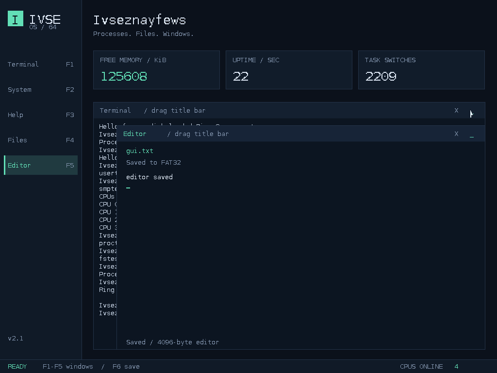

# Ivseznayfews OS

用 C++ 和 x86 汇编从零编写的实验性操作系统。当前主线为 **x86_64 / v2.1**，可以在 QEMU 中启动图形桌面，从 FAT32 磁盘加载多个 Ring 3 程序，使用 E1000 收发网络数据，并在多个 CPU 上执行内核工作队列。

项目适合学习引导、内存管理、中断、用户态隔离和设备驱动。当前验证目标是 **QEMU + BIOS**；完整功能的范围与限制见下文。



[快速启动](#快速启动) · [操作与命令](#操作与命令) · [功能与边界](#功能与边界) · [测试](#测试) · [开发文档](#开发文档)

## 快速启动

### 准备环境

使用 x86_64 Linux 开发环境，需要以下工具：

| 用途 | 工具 |
| --- | --- |
| 编译与链接 | GNU Make、g++、GNU binutils（ld、nm） |
| 汇编 | NASM |
| 生成 BIOS 启动 ISO | GRUB 的 `grub-mkrescue` 及 i386-pc 模块、xorriso、mtools |
| 生成磁盘与运行测试 | Python 3 |
| 运行虚拟机 | `qemu-system-x86_64`，图形启动需要 GTK 显示支持 |

字体位图已随源码提供，正常编译不需要 Pillow 或本机字体文件。QEMU 本体、固件和构建产物不随 Git 仓库分发；首次克隆后需要准备上述依赖。

### 编译并运行

```bash
git clone https://github.com/Ivseznayfews/ivseznayfews-os.git
cd ivseznayfews-os
make -C 64bit all disk
./64bit/run-vm.sh
```

也可以在仓库根目录执行 `make -C 64bit run`，完成构建、创建测试盘并打开虚拟机。

默认虚拟机使用 4 个 CPU、128 MiB 内存、TCG 软件模拟、BIOS 引导、IDE 测试盘和 E1000 用户网络 NAT。无需 KVM，也不配置入站端口转发。

| 产物 | 说明 |
| --- | --- |
| `64bit/ivseznayfews.iso` | 内核与 GRUB 启动镜像 |
| `64bit/ivseznayfews.elf` | 带符号的内核 ELF |
| `64bit/user/*.elf` | 用户态示例与隔离测试程序 |
| `64bit/.vm/disk-v2.1.img` | 64 MiB FAT32 测试盘，包含示例程序和说明文件 |
| `64bit/.vm/serial.log` | 虚拟机启动与调度日志 |

测试盘独立于 ISO。启动器默认持久化写入项目内的测试镜像；`VM_SNAPSHOT=1 ./64bit/run-vm.sh` 可使用临时写层。`make disk` 和磁盘生成脚本不会覆盖已有镜像；修改用户程序后，需要生成新镜像才能测试新的程序内容。

指定单核或其他 ISO：

```bash
VM_CPUS=1 ./64bit/run-vm.sh
./64bit/run-vm.sh /absolute/path/to/test.iso
```

同一时间只运行一个启动器实例，因为默认使用相同的日志文件和 monitor socket。更多说明见 [虚拟机测试指南](64bit/VM-TEST.md)。

## 操作与命令

默认进入 1024×768 深色桌面，支持 800×600 回退。开机时的 GRUB 菜单提供 **text recovery** 文本恢复入口。

| 操作 | 效果 |
| --- | --- |
| F1 / F2 / F3 / F4 / F5 | 打开或恢复 Terminal / System / Help / Files / Editor |
| Tab / Esc | 轮换页面 / 返回终端 |
| 点击侧栏或窗口 | 打开窗口或提升窗口焦点，保留各窗口内容 |
| 拖动终端标题栏 | 调整终端位置 |
| 标题栏 `_` / `X` | 最小化、关闭窗口；未保存的编辑器拒绝关闭 |
| F6 / Ctrl+S | 将编辑器内容保存到 FAT32 |

System 显示内存和调度状态，Files 显示实际挂载的 FAT32 根目录。桌面字体和 Shell 输入目前为 ASCII。

进入 Terminal 后，可以先执行：

```text
ls
cat readme.txt
run hello.elf
usertest
cpus
smptest
proctest
fstest
net
ping 10.0.2.2
```

`hello.elf` 会进入 Ring 3，通过系统调用输出文本并读取磁盘文件。`usertest` 验证非法指针、内核地址访问、无限循环和非法用户栈的处理，完成后返回 Shell。

| 命令 | 用途 |
| --- | --- |
| `help` / `about` | 查看命令和系统版本 |
| `clear` / `echo TEXT` | 清屏、输出文本 |
| `mem` / `tasks` / `uptime` | 查看内存、内核任务和运行时间 |
| `memtest` | 检查分配器内容完整性与计数 |
| `ls [PATH]` / `cat FILE` | 列出目录、读取文本文件 |
| `mkdir PATH` / `write PATH TEXT` / `fstest` | 创建目录、写入文本、文件系统自检 |
| `edit PATH` | 在图形编辑器中打开或新建文件 |
| `spawn FILE` / `ps` / `kill PID` / `wait PID` | 后台启动、查看、终止和回收用户进程 |
| `proctest` | 六进程并发、睡眠、隔离和资源回收检查 |
| `run FILE` / `usertest` | 运行用户态 ELF、执行隔离测试 |
| `cpus` / `smptest` | 查看在线核与工作量、执行多核自检 |
| `net` / `ping IP` | 查看网卡统计、发送 ICMP echo |
| `udp IP PORT TEXT` / `tcp IP PORT TEXT` | 发送诊断请求并等待响应 |
| `reboot` / `shutdown` / `halt` | 重启、关闭虚拟机、停止当前 CPU |

网络固定使用 `10.0.2.15/24`，网关为 `10.0.2.2`，与启动器的默认 QEMU NAT 配套。`ping 10.0.2.2` 可测试网关连通性；UDP/TCP 命令需要目标端口提供服务。完整自动测试会在宿主上临时启动回显服务，无需手工准备。

## 功能与边界

| 模块 | 当前实现 | 尚未实现或验证 |
| --- | --- | --- |
| 引导与中断 | GRUB Multiboot、64 位长模式、GDT/IDT、PIC、100 Hz PIT、串口 | UEFI 与真实硬件兼容性 |
| 内存 | 4 KiB 连续页分配、保留页保护、16 字节对齐堆、跨核分配锁 | 超出首个 1 GiB 页池的物理内存管理、换页 |
| 用户空间 | 独立页表、Ring 3、ELF64 加载、SYSCALL、RX/RW+NX 权限、睡眠、PID、异常与超时回收 | fork/exec、用户 Shell、浮点/SIMD 上下文保存 |
| 存储 | ATA PIO LBA28、单根 VFS 挂载、可读写 FAT32、8.3 路径、目录创建与扩展、跨簇读写 | 日志恢复、删除/重命名、长文件名、AHCI、Ext2 |
| 网络 | E1000、ARP、IPv4、ICMP、UDP、单连接 TCP 诊断客户端 | DHCP、DNS、IPv6、IP 分片重组、完整 TCP 重传与拥塞控制 |
| 多核 | ACPI 发现、xAPIC INIT/SIPI、最多 8 核、Spinlock、AP 工作队列 | 每核抢占调度、用户任务迁移、负载均衡、x2APIC |
| 图形桌面 | RGB 帧缓冲、软件绘图与光标、PS/2 鼠标、多窗口合成、焦点与遮挡、文件浏览、文本编辑器 | 用户态 GUI API、文本选择/光标移动、Unicode、DOOM 移植 |

Shell、桌面和驱动仍在 Ring 0。当前支持最多六个用户进程，每个程序仍保留三秒执行期限；BSP 运行原有抢占式内核任务，AP 执行非抢占工作队列。TCP 客户端用于短请求诊断，结束时发送 RST，不能替代通用 TCP 协议栈。

这些限制也是后续开发的方向。具体地址布局、系统调用 ABI、驱动范围和实现说明见 [v2.1 实现说明](64bit/SYSTEM-V2.1.md)。

## 测试

以下命令均在 `64bit` 目录执行。

### 主机测试与基本启动回归

```bash
cd 64bit
make test-host test-graphics
make test
```

主机测试覆盖 PMM/heap 分配、保留区域、边界条件、4000 次分配压力操作，以及帧缓冲格式、裁剪、字体和光标恢复。`make test` 还会启动实际 QEMU，注入 PS/2 键盘与鼠标输入，检查桌面与 Shell，并进行默认 65 秒的调度稳定性观察。

### 四核、用户空间、文件系统与网络完整回归

```bash
make all disk
SYSTEM_TEST=1 NETWORK_TEST=1 EXPECT_CPUS=4 \
QEMU_EXTRA='-smp 4 -drive file=.vm/disk-v2.1.img,format=raw,if=ide,snapshot=on -netdev user,id=net0 -device e1000,netdev=net0,romfile=' \
python3 tests/smoke.py
python3 tests/persistence.py
```

测试会检查磁盘读取、ELF 加载、用户程序错误隔离、AP 实际执行工作、窗口拖动与恢复，以及 ICMP/UDP/TCP 收发。网络回显服务仅绑定宿主 `127.0.0.1:19000` 和 `127.0.0.1:19001`，运行前需确保端口空闲。

| 环境变量 | 用途 |
| --- | --- |
| `SMOKE_SECONDS=3` | 缩短额外稳定性观察时间，默认 65 秒 |
| `TEST_PAYLOAD=800x600x32` | 使用临时 ISO 测试小分辨率图形模式 |
| `TEST_PAYLOAD=text` | 使用临时 ISO 测试文本恢复模式 |
| `SMOKE_ARTIFACTS=/absolute/path` | 保存截图和串口日志 |
| `QEMU` / `QEMU_EXTRA` | 指定模拟器路径和附加参数 |

验证包含四核回归、多进程隔离、FAT32 写入、多窗口编辑器、冷启动持久化和独立磁盘结构检查。网络验证覆盖 QEMU 网关和宿主回显，未验证公网 ICMP 可达性。详情见 [验证记录](64bit/tests/VALIDATION.md)。

## 源码导航

```text
ivseznayfews-os/
├── 64bit/                 当前开发主线
│   ├── boot/              长模式引导、AP 启动代码
│   ├── kernel/            内存、中断、调度、驱动、桌面与 Shell
│   ├── user/              Ring 3 示例程序与链接脚本
│   ├── iso/boot/grub/     启动菜单配置
│   ├── tests/             主机测试、QEMU 回归与验证记录
│   ├── tools/             FAT32 测试盘、字体生成工具
│   ├── licenses/          字体许可
│   ├── Makefile           构建与测试入口
│   └── run-vm.sh          图形虚拟机启动器
├── 32bit/                 保留的早期实现，本轮不维护
└── docs/images/           README 使用的实际运行截图
```

构建产物和 `.vm/` 运行目录由 Git 忽略。`32bit/` 作为历史源码保留，其能力和测试状态不代表当前 64 位主线。

## 开发文档

- [64 位开发说明](64bit/README.md)：图形输出、内存与任务切换实现。
- [v2.1 三项联动实现](64bit/SYSTEM-V2.1.md)：多进程、可写 FAT32、多窗口和编辑器。
- [v2.0 系统基础扩展](64bit/SYSTEM-V2.md)：用户态 ABI、存储、网络、多核及限制。
- [虚拟机测试指南](64bit/VM-TEST.md)：本地运行、配置和日志位置。
- [验证记录](64bit/tests/VALIDATION.md)：各阶段复现结果与覆盖范围。

## 许可

项目沿用原有 README 的 MIT 许可声明；当前仓库尚未附独立的 MIT LICENSE 文件。内置 ASCII 字体位图来自 DejaVu Sans Mono，其许可单独保存在 [DejaVu.txt](64bit/licenses/DejaVu.txt)。
